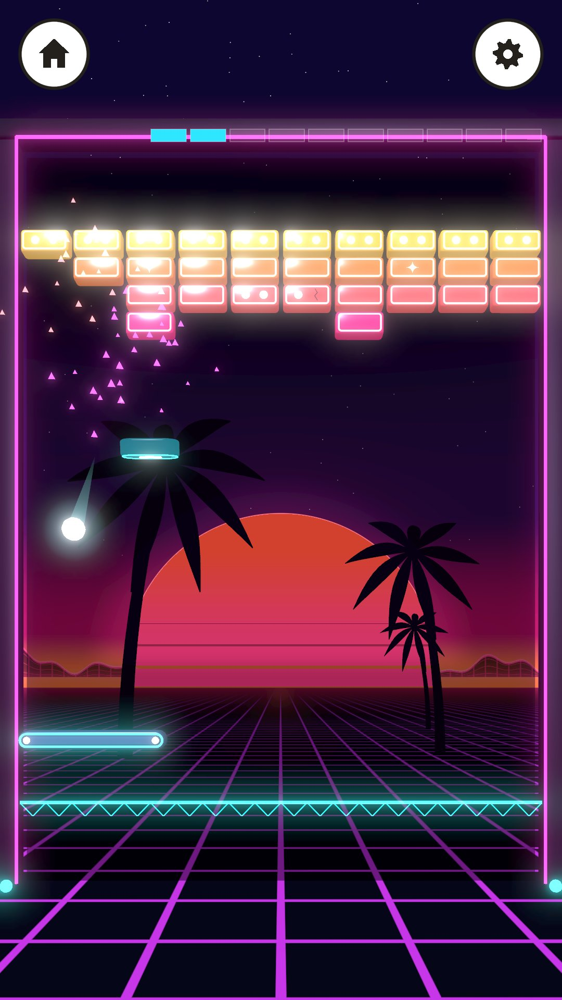
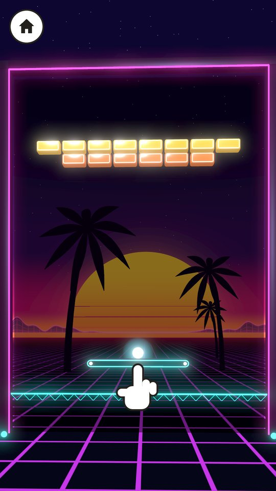
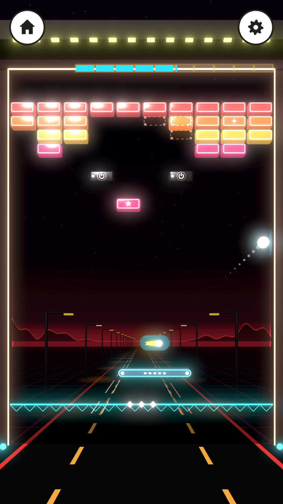
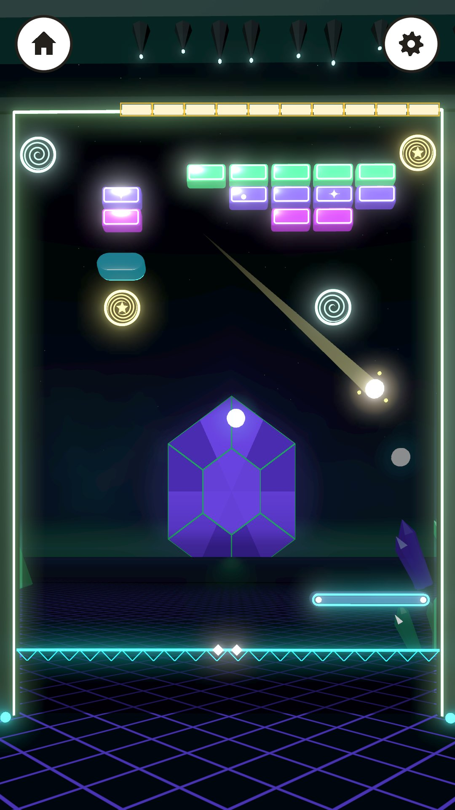
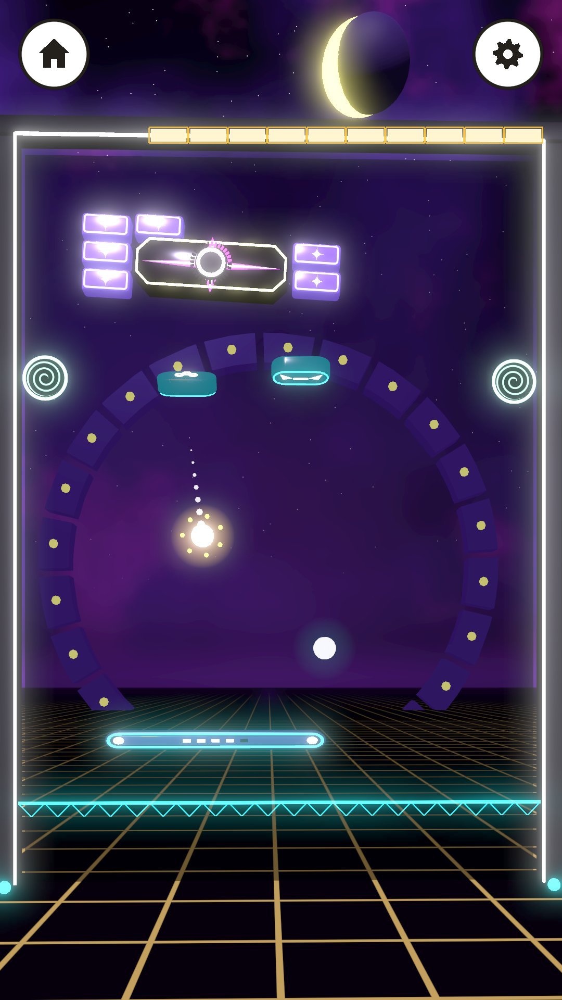

# MWM Neon Bricks

A neon synthwave brick breaker for Android, made for children (ages 4-7 on "Lett", 8+ on "Vanlig"). Steer a glowing paddle with one thumb and bounce a ball through bright 3D bricks on a sunset beach. A safety net under the paddle means a small child never loses. No ads, no tracking, works offline, no Android permissions.

 <em>Level 4 in Neonstranda, mid-play: the ball with its tail, the glowing bricks, the paddle and the net under it.</em>

## Download

**[⬇ Download the APK (Android, about 190 MB)](https://github.com/Matswm86/mwm-neon-bricks/releases/download/latest/mwm-neon-bricks.apk)**

1. On the device, tap [mwm-neon-bricks.apk](https://github.com/Matswm86/mwm-neon-bricks/releases/download/latest/mwm-neon-bricks.apk) (or open the [latest release](https://github.com/Matswm86/mwm-neon-bricks/releases/tag/latest)).
2. Open the file and, if Android asks, allow "Install unknown apps" for the browser or file manager you opened it from.
3. If an older build will not update (signature mismatch), uninstall it first.

The APK runs on 64-bit phones and 32-bit tablets (arm64-v8a and armeabi-v7a). It is debug-signed, for sideloading only.

## What it does

- Play 30 levels in 6 worlds, five levels each, every world ending in a boss: Neonstranda (beach), Rutenettbyen (city), Arkadehallen (arcade), Nattveien (night highway), Krystallgrotta (crystal cave) and Stjerneporten (star gate).
- Break bricks: Glass, Double, Triple, Nova, Glider, Chrome, Switch + Ghost, Magnet, portal pairs and march blocks (a formation that slides and steps down).
- Catch capsules for power-ups: Komet, Ekko, Bredvinge, Neonpuls, Saktetid and Skjoldnett.
- After world 1 is cleared, the last map page "Neonveien" opens endless generated levels.
- Pick "Lett" (ages 4-7: the net under the paddle never runs out) or "Vanlig" (8+: faster, and the net has three charges on most levels after world 1) in the settings gear; the change applies from the next level.
- Turn sound and music on or off, set their volume, and switch on "Mindre bevegelse" (less motion).

| Level 1 start | Night highway (world 4) | Crystal cave (world 5) | Star gate boss (world 6) |
|---|---|---|---|
|  |  |  |  |

## How to play

- Put a thumb anywhere in the lower part of the screen and slide it: the paddle follows the slide (it never jumps to the finger, so the thumb never covers the ball).
- Lift the thumb to launch the ball, or wait 3 seconds and it launches itself.
- A brick with a star drops a capsule; catch it for a power-up (Komet ploughs through bricks, Ekko splits the ball, Saktetid slows it, and more).
- Clear every brick that glows (chrome and switches never break) to get the star. Hit a switch, or wait, and the dashed ghost bricks swap which set is solid.
- Hold three fingers on the screen for about a second to show the performance readout (fps, draw calls, memory).

## How it works

The game is a Godot 4.6 project written in GDScript, using the `mobile` renderer in portrait 1080x1920; GitHub Actions exports the Android APK. The rules (ball, paddle, bricks, capsules, bosses, net) are plain logic with no scene nodes, so the same code runs the game, the headless tests and the bot that clears every level. A 3D scene draws that logic: bricks, paddle and capsules are GLB models, custom shaders handle the bricks, ghosts, portals and net, and each world has its own sky, floor and props. Levels are text grids in one data file, and the endless levels are generated from templates, so the same level number and save always give the same map. Sound effects are pre-rendered .ogg files made by a Python tool, and the music is one synthwave track. Design: `docs/GDD.md` (rules and numbers) and `docs/DESIGN.md` (look).

## Status

Version 0.1.0, a playable sideload build with all 30 levels and the endless levels. Not done yet: a Google Play release and a frame-rate check on real devices (the QA run in `docs/QA_FULL_2026-10-07.md` was done on a laptop).

## For a host app (MWM Play)

The autoload `NeonBricks` holds the hooks: `set_full_unlock(on)` (default `true`, so the stand-alone build has every level open), `set_difficulty(easy)`, `set_shell_inset(inset)`, `set_sfx_on`, `set_music_on`, `set_haptics_on`, `set_less_motion`, `save_game()`, and the signals `level_card_shown(level_id)` and `free_levels_finished()`. With `Engine.set_meta(&"mwm_play_shell", true)` the game hides its own home disc and settings gear and leaves the back button to the host. Save file: `user://neon_bricks_save.json`.

## Development

- Godot 4.6, `mobile` renderer, portrait 1080x1920. APKs are built by GitHub Actions on every push to `main`.
- Logic test (net, gentle restart, bot clears world 1, flash limiter, save): `godot --headless --audio-driver Dummy res://tests/net_test.tscn`
- Level test (bot clears all 30 levels in both settings, pacing, ghost / portal / magnet / march logs, endless generator, flash limiter in the game loop): `godot --headless --audio-driver Dummy res://tests/levels_test.tscn` (about 10 minutes; `LEVELS_ONLY=<id>`, `LEVELS_SEEDS=<n>`)
- Screenshot bot: `tests/capture.tscn` (phases `shots`, `inset`, `tall`, `shell`, `action`, `worlds`; see the header of `tests/capture.gd`).
- Pacing reference: `python3 tools/action_sim.py` (Python sim the levels were designed with).
- Lint: `gdlint scripts tests` and `gdformat --check scripts tests`.

Credits and licences: `CREDITS.md`. Font: Fredoka (SIL OFL 1.1, `assets/fonts/Fredoka-OFL.txt`).
